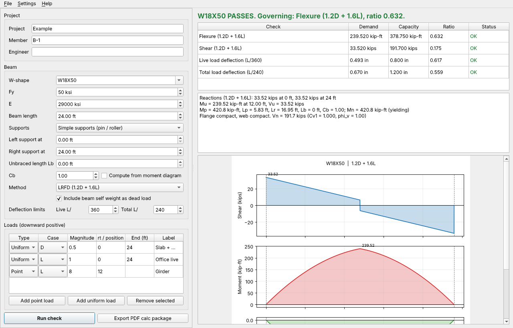

# Beam Check Desk

A Windows desktop app that checks a steel W-shape beam the way you would by hand, then writes the calc package for you.

Pick a shape from the AISC table, enter the span, supports and loads, and Beam Check Desk draws the shear, moment and deflection diagrams, runs the AISC 360-22 flexure, shear and deflection checks, and exports a PDF calc package with a plain-English narrative. If you give it a Claude API key, Claude writes that narrative from the computed numbers (it never computes anything itself). Without a key the app still works fully offline with a template narrative.

> Student-built tool for checking hand calculations. Not for use on real design work.



A sample calc package is in [docs/sample-calc-W18x50.pdf](docs/sample-calc-W18x50.pdf).

## Download

Grab `BeamCheckDesk.exe` from the latest [release](../../releases/latest) and double-click it. No install, no Python needed. Windows SmartScreen may warn because the exe is unsigned; choose "More info" then "Run anyway".

Every push to `main` also builds the exe as a GitHub Actions artifact.

## What it checks

| Check | Reference |
| --- | --- |
| Flexure: yielding, lateral-torsional buckling (Lp, Lr, Cb) | AISC 360-22 Section F2 |
| Flexure: noncompact and slender flanges | AISC 360-22 Section F3 |
| Shear in the web | AISC 360-22 Section G2.1 |
| Live and total load deflection | L/360 and L/240 by default, editable |

Beams can be simply supported (with overhangs) or cantilevered. Loads are point and uniform, tagged dead or live. LRFD uses 1.2D + 1.6L; ASD uses D + L. Deflection always uses service loads. Self weight can be added automatically.

Section properties come from the AISC Shapes Database v16.0 (289 W-shapes), via the Apache-2.0 licensed [steelpy](https://pypi.org/project/steelpy/) package.

## Verification

`tests/` checks the solver against textbook formulas and the AISC Manual:

- Simple span uniform load: wL²/8 and 5wL⁴/384EI
- Midspan point load: PL/4 and PL³/48EI
- Cantilever tip load: PL and PL³/3EI, both fixed-end directions
- Overhang reactions and hogging moment over the support
- W18x50, Fy = 50 ksi: φMp = 379 kip-ft, φVn = 192 kips, Lp = 5.83 ft, Lr = 16.9 ft (Manual Table 3-2), φMn = 324 kip-ft at Lb = 10 ft
- Cb = 1.14 for a uniformly loaded simple span (Manual Table 3-1)

```
pip install -r requirements.txt
python -m pytest
```

## Run from source

```
pip install -r requirements.txt
python -m beam_check_desk
```

## Build the exe yourself

```
pyinstaller packaging/beam_check_desk.spec --noconfirm
```

The exe lands in `dist/BeamCheckDesk.exe`. The GitHub Actions workflow in `.github/workflows/build.yml` does the same on `windows-latest` and attaches the exe to any `v*` tag as a release.

## Claude narrative

Settings > Claude API key. The key is stored in `%APPDATA%\BeamCheckDesk\settings.json` and is only sent to the Anthropic API when you export a PDF. The model receives a JSON summary of the finished check and is instructed to quote those numbers, name the governing check, and suggest next steps if something fails.

## Layout

```
beam_check_desk/
  model.py       inputs (BeamInput, PointLoad, UniformLoad)
  analysis.py    reactions, shear, moment, deflection by double integration, Cb
  checks.py      AISC 360-22 F2, F3, G2
  engine.py      load combinations and the full check
  plots.py       diagrams (matplotlib)
  report.py      PDF calc package (ReportLab)
  narrative.py   Claude narrative with offline template fallback
  ui/            PySide6 window
  data/          AISC W-shape table
tests/           pytest suite
packaging/       PyInstaller spec
```

## License

MIT.
